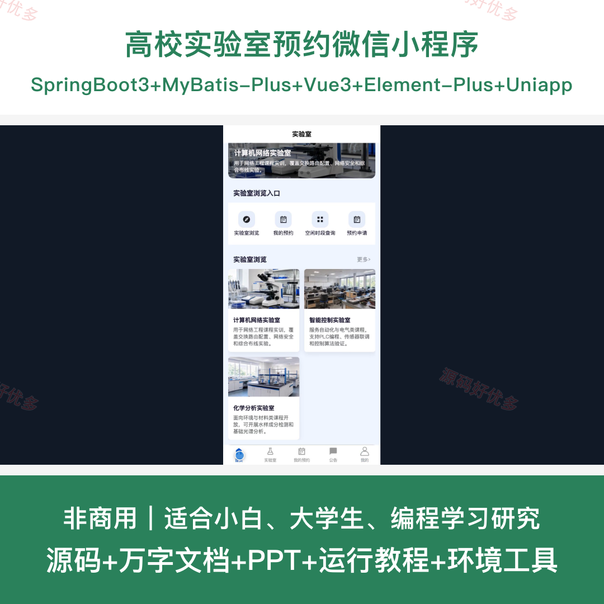
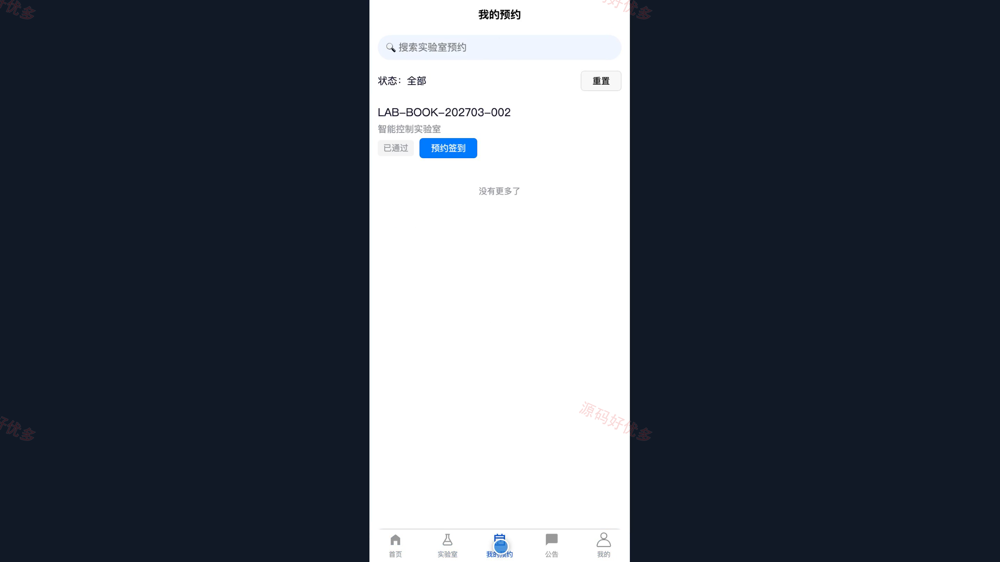
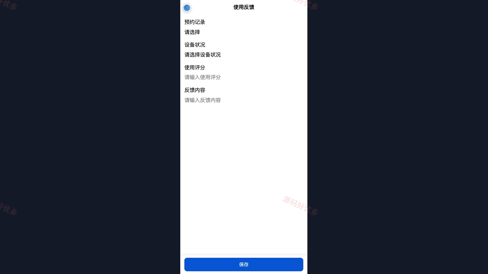
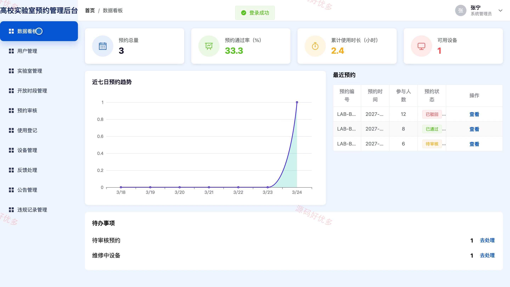
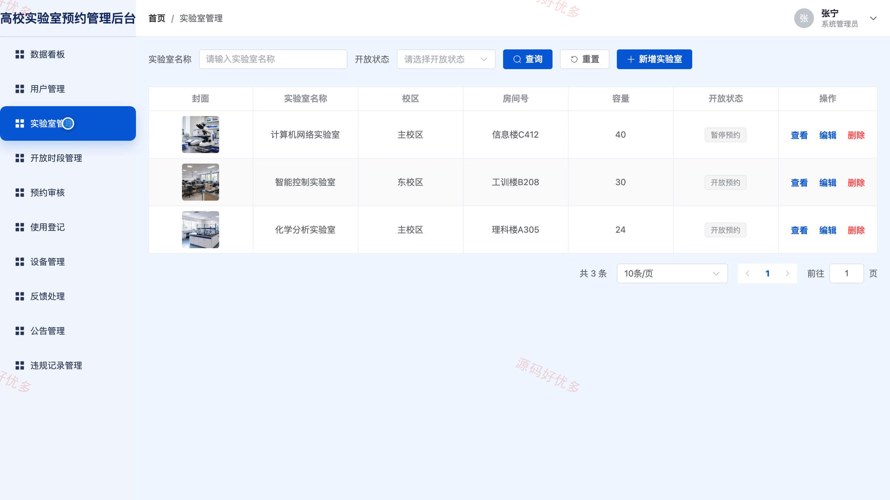
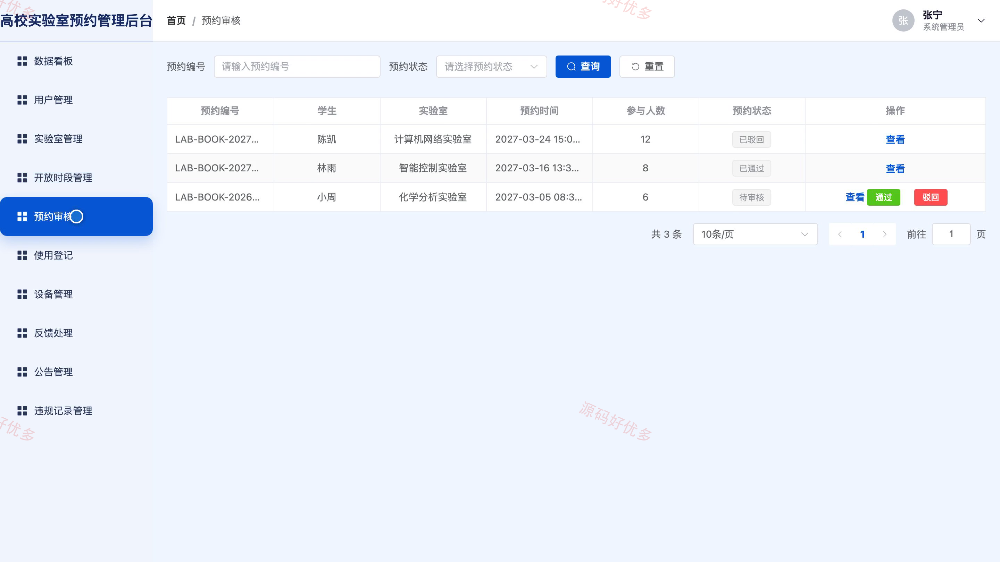

# bs009B
bs009B高校实验室预约小程序源码 Java SpringBoot3 Vue3 文档 PPT
## 源码问题查看主页咨询

### 一、关键词
实验室预约、教学场地预订、实验资源管理、开放时段预约、安全使用登记

### 二、作品包含
源码+数据库+万字设计文档+PPT+全套环境和工具资源+本地部署教程

### 三、项目技术
前端技术： Html、Css、Js、Vue3.4、Element-Plus、uniapp
后端技术：Java、SpringBoot3.2.0、MyBatis-Plus

### 四、运行环境要求
开发工具：IDEA/eclipse + VSCODE + HBuilder X + 微信开发者工具

数据库：MySQL5.7+（共14张表）

数据库管理工具：Navicat10以上版本

环境配置软件： JDK17 + Maven3.6

前端Nodejs：20

浏览器：谷歌浏览器

### 五、项目介绍
项目编号：bs009B

高校实验室预约小程序面向学生与系统管理员，围绕实验室信息查询、开放时段预约、预约审核、签到登记、设备维护、使用反馈及违规管理形成完整业务闭环。

角色：学生、系统管理员

学生功能：账号注册与登录、实验室筛选与详情查看、空闲时段查询、预约申请与审核进度查看、预约取消与签到、使用反馈提交、公告与安全要求查看、个人资料与密码维护。

系统管理员功能：学生账号与预约资格管理、实验室与开放时段管理、预约审核与冲突管控、签到签退与使用登记、设备状态管理、反馈处理、公告与安全规则管理、违规限制与预约统计。

### 六、运行截图

